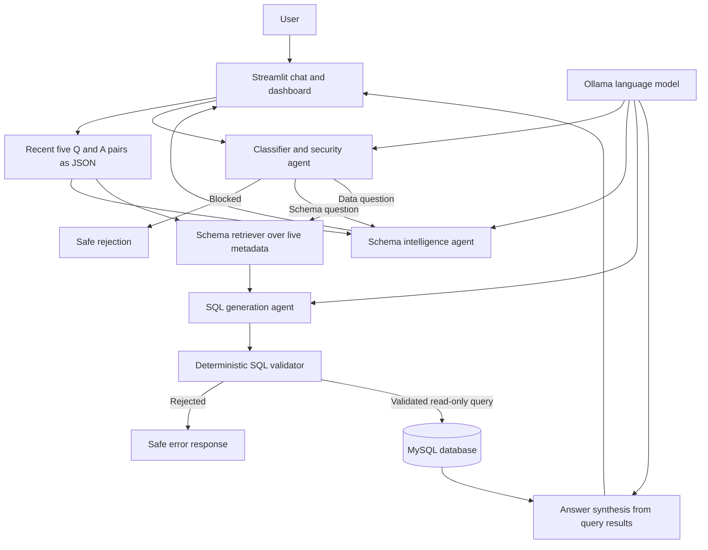

# FA Activity Submission Checklist

## Activity

**Title:** Design, Develop and Demonstrate an Agentic AI Application for a Real-World Problem  
**Project:** SQL Sentinel — Multi-Agent Database Assistant  
**Group size:** 1 or 2 students  
**Maximum marks:** 40  
**Assessment mode:** Practical implementation, demonstration, and viva  
**Technology in this project:** Python, Streamlit, LangGraph, LangChain, Ollama, MySQL, and schema retrieval

> The activity brief's duration/date line is unclear ("12th October 16th to 2026"). Confirm the actual submission deadline with the instructor.

## Required submission items

- [ ] **Title and student details**
  - Project title: SQL Sentinel — Multi-Agent Database Assistant
  - Student name(s): ______________________________
  - Roll number(s): ________________________________
  - Class/division: _________________________________
  - Instructor/subject: ______________________________

- [ ] **Architecture diagram**
  - Include the diagram below in the report or as a separate image.
  - Make sure the diagram is readable in the final PDF/document.

- [ ] **Working application**
  - Demonstrate the running Streamlit application with a working database and Ollama model.
  - Show a schema question, a data question, a follow-up question, and a rejected/unsafe request.
  - Capture screenshots or a short recording as evidence if requested by the instructor.

- [ ] **Source code**
  - Submit a GitHub repository link or a ZIP archive.
  - Include application source, tests, `requirements.txt`, `.env.example`, and setup instructions.
  - Do **not** include `.env`, database credentials, API keys, or the local `venv` folder.

- [ ] **Test report**
  - The activity requires at least 5 test cases.
  - Run the tests and record the actual pass/fail result; do not mark tests as passed until they have been run.
  - The project currently contains tests for retrieval, SQL safety/validation, structured SQL response parsing, and recent chat history.

- [ ] **Short report**
  - Use the required structure in the report outline below.

## Project architecture



**Architecture notes:** Retrieval supplies relevant live schema metadata to the agents; business data is obtained through validated read-only SQL. The workflow uses conditional routing and a deterministic validator before database execution. Recent conversation history helps resolve follow-up questions and is kept within the current Streamlit session.

## Short report outline

Use these sections in the project report:

1. **Introduction** — Introduce SQL Sentinel and the purpose of a conversational database assistant.
2. **Problem Statement** — Explain why users may need natural-language access to database schema and business information, and the risks of unrestricted SQL access.
3. **Objectives** — List the goals: understand user questions, retrieve relevant schema, generate useful answers, and enforce read-only safety.
4. **Proposed Agent Architecture** — Describe the Streamlit UI, classifier/security agent, schema agent, SQL agent, retrieval, validator, database, and answer-synthesis flow. Add the architecture diagram.
5. **Prompt Design** — Explain agent roles, output constraints, schema grounding, and how recent JSON chat context supports follow-ups.
6. **RAG Implementation** — Describe retrieval over live schema metadata. Clarify that business rows are fetched from the database, not the retrieval index.
7. **Tool/API Integration** — Describe LangGraph, LangChain/Ollama, SQLAlchemy/MySQL, and the schema inspection/query tools.
8. **Agent Workflow** — Explain classification, conditional routing, schema retrieval, SQL generation where needed, validation, execution, and answer generation.
9. **Safety Mechanism** — Cover blocked requests, single-statement read-only SQL validation, known-table checks, result limits, query timeouts, and using a database account with read-only permissions.
10. **Results** — Include the actual test results and evidence from the working application. State which questions were demonstrated.
11. **Limitations** — Mention dependency on the configured database and Ollama model, ambiguity in natural-language questions, and that answers are limited by available schema/data.
12. **Future Scope** — Suggest improvements such as more database dialects, persistent user-managed history, richer observability, and deployment hardening.

## Test report

Run from the project directory:

```powershell
python -m pytest -v tests
```

Record the real result below after running the command:

| Item | Result |
|---|---|
| Date/time run | ______________________________ |
| Python version | ______________________________ |
| Command | `python -m pytest -v tests` |
| Passed | ______________________________ |
| Failed | ______________________________ |
| Skipped | ______________________________ |
| Overall result | Pending test run |

Test cases currently present in the project:

| # | Test case | Expected result |
|---:|---|---|
| 1 | Retrieve relevant schema for a sales question | Relevant sales schema is returned |
| 2 | Allow a valid bounded SELECT query | Query passes validation |
| 3 | Reject an UPDATE query | Query is rejected |
| 4 | Reject multiple SQL statements | Query is rejected |
| 5 | Reject a query that references an unknown table | Query is rejected |
| 6 | Add a row limit when one is missing | Validated SQL has the configured limit |
| 7 | Block a request to reveal a database password | Deterministic safety rule blocks it |
| 8 | Parse SQL from a structured agent response | SQL is extracted |
| 9 | Reject a structured response missing SQL | Parser raises a validation error |
| 10 | Remove a Markdown SQL fence from parsed SQL | Clean SQL is returned |
| 11 | Keep only the previous five chat exchanges | JSON contains at most ten messages |
| 12 | Preserve Unicode in serialized chat history | JSON round-trips the original text |

## Demonstration and viva preparation

- [ ] Start MySQL and confirm the configured database is reachable.
- [ ] Start Ollama and confirm the configured model is available.
- [ ] Start the app using the setup instructions in `README.md`.
- [ ] Demonstrate a schema question, such as “Which tables and primary keys are available?”
- [ ] Demonstrate a data question, such as “Count employees by department.”
- [ ] Ask a follow-up question that refers to the previous answer.
- [ ] Demonstrate that an unsafe or unsupported request is blocked or safely declined.
- [ ] Show the generated SQL, validation status, execution trace, and result preview.
- [ ] Be ready to explain RAG, agent routing, SQL validation, read-only permissions, and limitations.

## Assessment rubric

| Assessment criterion | Marks |
|---|---:|
| Problem Definition & Agent Suitability | 4 |
| Advanced Prompt Engineering | 4 |
| Agent Architecture & Planning | 6 |
| RAG / Knowledge Integration | 5 |
| Tool / API Integration | 5 |
| Working Agentic AI Application | 5 |
| Safety, Ethics & Responsible AI | 3 |
| Testing, Demonstration & Viva | 3 |
| Timely Submission | 5 |
| **Total** | **40** |

## Final packaging checklist

- [ ] Report includes all 12 suggested sections and the architecture diagram.
- [ ] Source code is submitted through the chosen repository or ZIP.
- [ ] `README.md`, `requirements.txt`, `.env.example`, and tests are included.
- [ ] Credentials, `.env`, and local virtual-environment files are excluded.
- [ ] Test results are recorded from an actual run.
- [ ] Application screenshots/demo evidence are included if requested.
- [ ] Student details and confirmed submission deadline are filled in.
